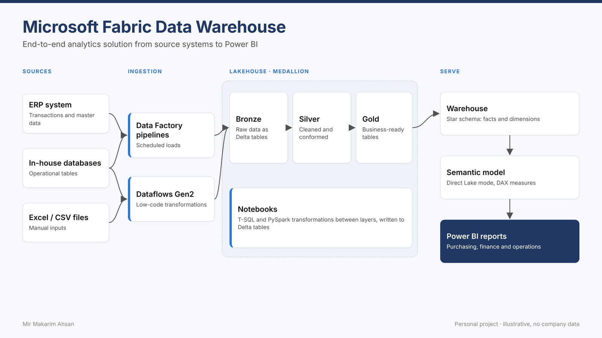
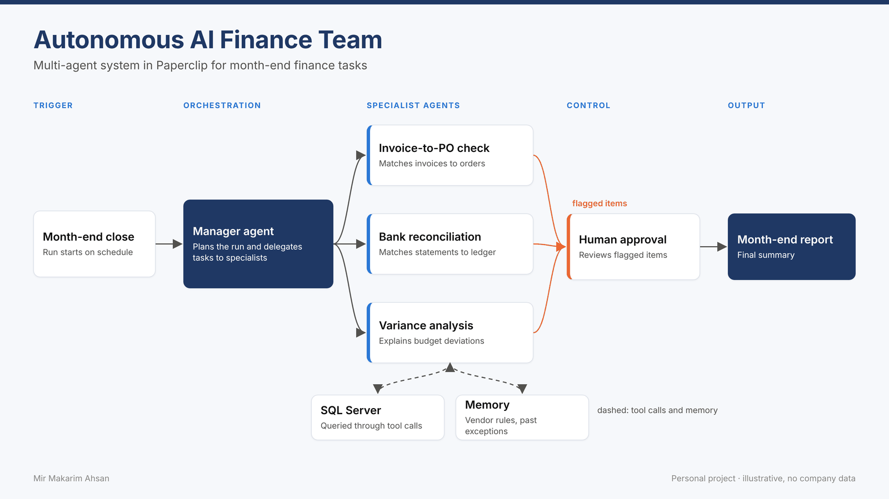
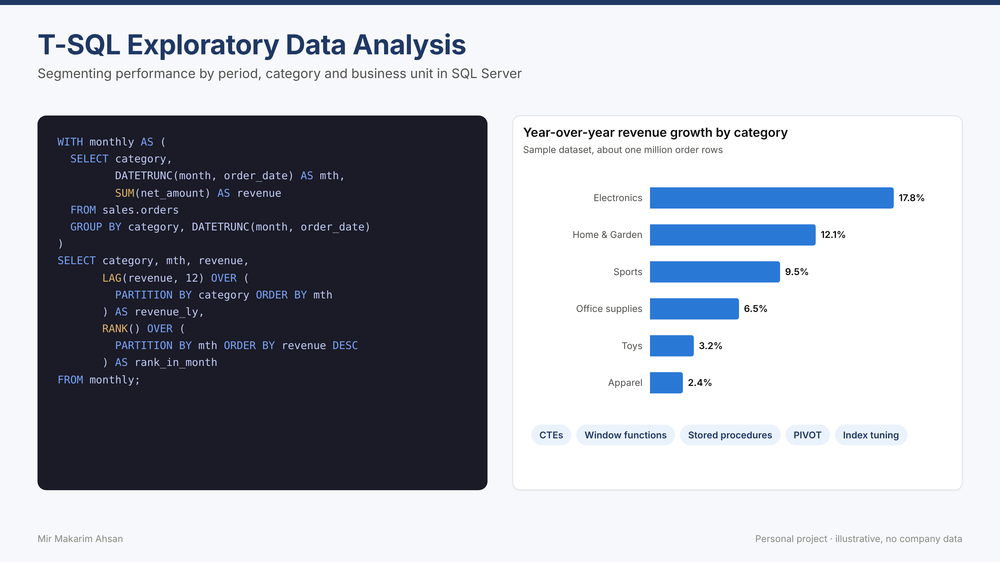
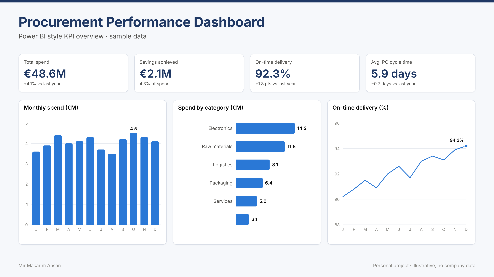
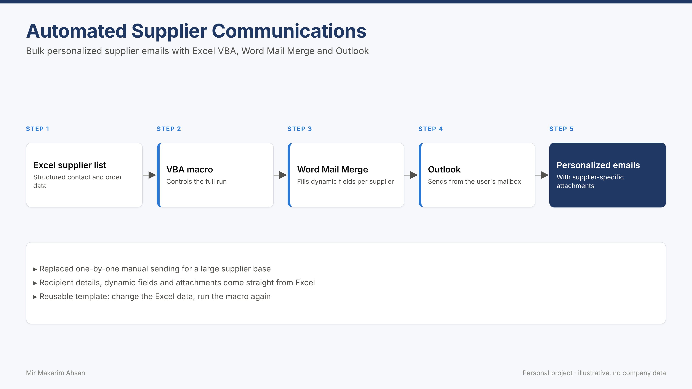
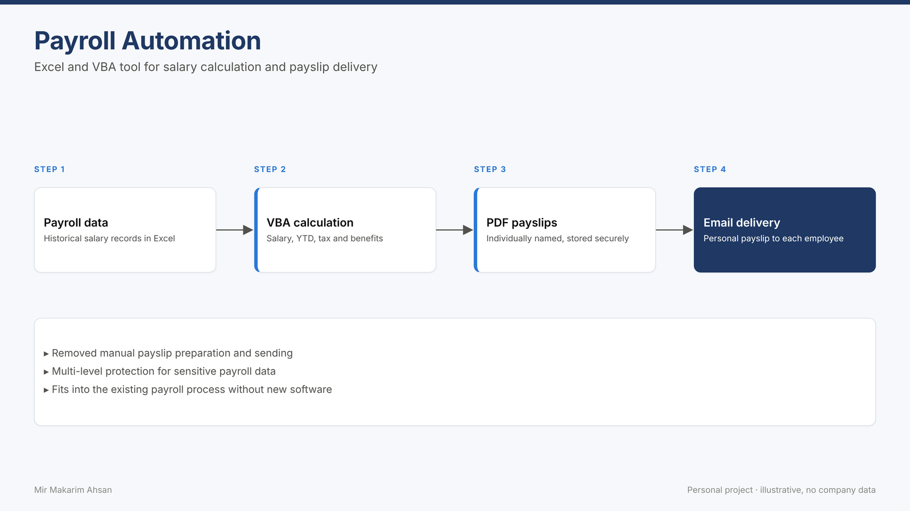

<p align="center">
  
</p>

<p align="center">
  <a href="https://www.linkedin.com/in/mirmakarim"></a>
  <a href="mailto:ahsanmakarim@gmail.com"></a>
</p>

---

### `> whoami`

```sql
SELECT name, role, based_in, focus
FROM   professionals
WHERE  github = 'MirMakarim';
```

| name | role | based_in | focus |
|:--|:--|:--|:--|
| **Mir Makarim Ahsan** | Working Student, Global Purchasing Excellence and Strategy @ FORVIA HELLA | Soest, Germany 🇩🇪 | BI · Data Engineering · Automation · AI Agents |

I turn manual reports into data products that run on their own. My background is finance and treasury; today I build reporting, data models and digital tools for purchasing teams.

- 🏭 &nbsp;Building procurement analytics with **Power BI**, **SAP Analytics Cloud** and **Palantir**
- 🧱 &nbsp;Exploring **Microsoft Fabric** lakehouses and **multi-agent AI** for finance
- 🎓 &nbsp;Completing an **M.A. in International Management and Information Systems** (2027)
- 🗣️ &nbsp;English (C1) · German (A2, learning)

---

### 🛤️ &nbsp;Career pipeline

<p align="center">
  
</p>

---

### 🧰 &nbsp;Tech stack

<p align="center">
  
</p>

---

### 📄 &nbsp;Resume projects

<p>
  <a href="https://github.com/stars/MirMakarim/lists/resume-projects"></a>
</p>

<table>
  <tr>
    <td width="50%" valign="top">
      <a href="https://github.com/MirMakarim/fabric-data-warehouse"></a>
      <h4>🧱 Microsoft Fabric Data Warehouse</h4>
      Medallion lakehouse from source systems to Power BI.<br/>
      <sub><code>Fabric</code> <code>Data Factory</code> <code>PySpark</code> <code>T-SQL</code> <code>Direct Lake</code></sub>
    </td>
    <td width="50%" valign="top">
      <a href="https://github.com/MirMakarim/ai-finance-agent-team"></a>
      <h4>🤖 Autonomous AI Finance Team</h4>
      Multi-agent system for invoice checks, reconciliation and variance analysis.<br/>
      <sub><code>AI Agents</code> <code>Paperclip</code> <code>SQL Server</code> <code>Human-in-the-loop</code></sub>
    </td>
  </tr>
  <tr>
    <td width="50%" valign="top">
      <a href="https://github.com/MirMakarim/tsql-exploratory-analysis"></a>
      <h4>🔎 T-SQL Exploratory Data Analysis</h4>
      Segmenting performance by period, category and business unit.<br/>
      <sub><code>SQL Server</code> <code>CTEs</code> <code>Window functions</code> <code>Query tuning</code></sub>
    </td>
    <td width="50%" valign="top">
      <a href="https://github.com/MirMakarim/procurement-powerbi-dashboard"></a>
      <h4>📊 Procurement Performance Dashboard <sub>🚧 in progress</sub></h4>
      Spend, savings, on-time delivery and PO cycle time on sample data.<br/>
      <sub><code>Power BI</code> <code>DAX</code> <code>Data modeling</code> <code>Star schema</code></sub>
    </td>
  </tr>
  <tr>
    <td width="50%" valign="top">
      <a href="https://github.com/MirMakarim/vba-supplier-mail-merge"></a>
      <h4>✉️ Automated Supplier Communications</h4>
      Personalized bulk emails with attachments, straight from Excel.<br/>
      <sub><code>Excel VBA</code> <code>Word Mail Merge</code> <code>Outlook</code></sub>
    </td>
    <td width="50%" valign="top">
      <a href="https://github.com/MirMakarim/vba-payroll-automation"></a>
      <h4>🧾 Payroll Automation</h4>
      Salary calculation, PDF payslips and email delivery in one run.<br/>
      <sub><code>Excel VBA</code> <code>PDF</code> <code>Outlook</code></sub>
    </td>
  </tr>
</table>

<!--
==========================================================================
 MORE PROJECT SECTIONS · hidden until they have content.
 To show a section: move it out of this comment block and fill in the cards.
==========================================================================

### 🧩 &nbsp;Complex builds

<p><a href="https://github.com/stars/MirMakarim/lists/complex-builds"></a></p>

<table>
  <tr>
    <td width="50%" valign="top">
      <a href="https://github.com/MirMakarim/REPO"></a>
      <h4>PROJECT NAME</h4>
      One-line description.<br/>
      <sub><code>Tool</code> <code>Tool</code> <code>Tool</code></sub>
    </td>
    <td width="50%" valign="top">
      (second card or leave empty)
    </td>
  </tr>
</table>

### 🧪 &nbsp;Learning and experiments

| Project | What I tried | Tools |
|:--|:--|:--|
| [REPO](https://github.com/MirMakarim/REPO) | One line | `Tool` `Tool` |

<sub>Full list: <a href="https://github.com/stars/MirMakarim/lists/learning-experiments">Learning and Experiments</a></sub>

### 💡 &nbsp;Inspiration

Repositories by others that I learn from:

- [owner/repo](https://github.com/owner/repo) · why it is useful

<sub>Full list: <a href="https://github.com/stars/MirMakarim/lists/inspiration">Inspiration</a></sub>
-->

---

### 🏅 &nbsp;Certifications

<p>
  
  
  
  <br/>
  
  
  
</p>

<details>
  <summary><b>🎓 Education</b></summary>
  <br/>

  | Degree | Institution | Year |
  |:--|:--|:--|
  | M.A. International Management and Information Systems | Fachhochschule Südwestfalen, Germany | expected 2027 |
  | Master of Business Administration (MBA) | University of Dhaka, Bangladesh | 2019 |
  | Bachelor of Business Administration (BBA) | University of Dhaka, Bangladesh | 2017 |
</details>

---

<p align="center">
  
</p>
